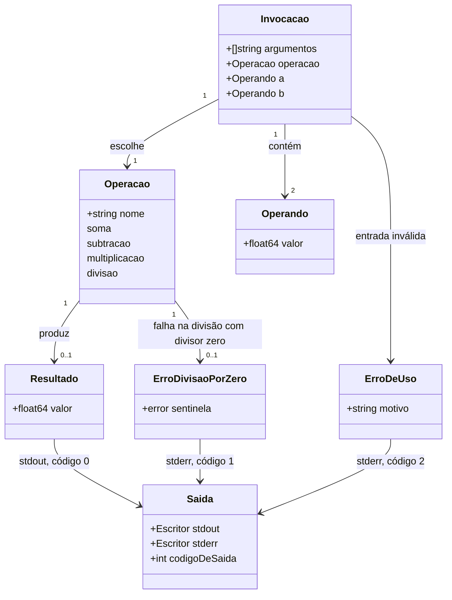

# Calculadora básica de linha de comando em Go

Decisões resolvidas pelo humano: D-A1 (sintaxe `calc <operacao> <a> <b>`), D-A2 (saída), D-A3 (`float64`), D-A4 (códigos de saída 0/1/2), D-A5 (módulo) e D-A14 (executável `calc`, ponto de entrada `cmd/calc/main.go`). Itens ainda "não informados", que NÃO podem ser supostos na geração (se a geração depender de um deles, pare e pergunte): D-A6 (confirmação de dois operandos), D-A8 (entrada inválida, mantida como proposta), D-A9 (formato de impressão do float), D-A10 (overflow/`Inf`/`NaN`), D-A11 (separador decimal), D-A12 (versão mínima do Go), D-A13 (idioma dos identificadores). Fonte: `openspec/changes/calculadora-basica/design.md`.

## Requirements

Implementar uma calculadora de linha de comando em Go que executa soma, subtração, multiplicação e divisão sobre dois operandos `float64` e trata a divisão por zero como erro devolvido, nunca como pânico, para que o usuário receba sempre um resultado em stdout ou uma mensagem de erro em português em stderr, com código de saída que distingue o tipo de falha.

Limites: uma operação por execução e exatamente dois operandos, na forma `calc <operacao> <a> <b>`; sem modo interativo, histórico nem expressões compostas; sem alteração do `harness.config.json` (o `sensors_command` será `go test ./...`, definido à parte pelo humano).

## Entities

Notas: a operação é identificada por nome em português sem acento. As entidades podem ser tipos simples ou funções; não criar hierarquias nem wrappers além do necessário (restrição conservadora). `ErroDeUso` cobre operação desconhecida, operando não numérico, argumentos ausentes ou em excesso (D-A8, proposto). Sem reutilização de código existente: o projeto é greenfield.

## Approach

1. Separação de responsabilidades:
   - A regra de cálculo fica isolada, sem E/S, para ser testada diretamente.
   - A interpretação de argumentos e a apresentação ficam em uma camada testável que recebe argumentos e escritores de `stdout`/`stderr` em vez de ler o ambiente global.
   - O ponto de entrada `cmd/calc/main.go` só liga o ambiente real (argumentos do processo, `os.Stdout`, `os.Stderr`, código de saída) à camada acima.
2. Implementação técnica:
   - Apenas biblioteca padrão do Go; módulo `github.com/emilianoeloi/calculadora_go`.
   - Erros como valor (`error`); erro sentinela para divisão por zero, identificável com `errors.Is`.
   - Sem `panic` e sem `recover`.
   - Tratamento centralizado de erros na camada de CLI: o único lugar que converte erro em mensagem em stderr e código de saída (1 para divisão por zero, 2 para uso).
3. Regras de negócio:
   - Divisor zero (inclusive `-0`, consequência direta de `float64`) na divisão devolve erro; dividendo zero com divisor não zero devolve zero; a divisão não trunca.
   - Entrada inválida devolve erro de uso, sem pânico (D-A8, proposto).
   - `<a>` é o minuendo/dividendo e `<b>` o subtraendo/divisor.
4. Riscos e respostas: o formato de impressão do float (D-A9) não está definido, então os testes de saída comparam o valor numérico lido e não o texto exato; overflow/`Inf`/`NaN` (D-A10) não é especificado nem testado até haver decisão.

## Structure

### Inheritance Relationships
1. Não há hierarquia de herança (Go não a tem). Os erros de domínio são valores que implementam `error`; o erro de divisão por zero é um valor sentinela.
2. Se uma abstração for necessária (por exemplo, para a seleção de operação), usar interface pequena definida onde é consumida. Só se houver necessidade comprovada pelos testes.

### Dependencies
1. O ponto de entrada `cmd/calc/main.go` depende da camada de interpretação/apresentação.
2. A camada de interpretação/apresentação depende do pacote de cálculo.
3. O pacote de cálculo não depende de nenhum outro pacote do projeto nem de E/S.
4. Os pacotes de produção usam apenas a biblioteca padrão.

### Layered Architecture
1. Entrada (`cmd/calc`): liga o processo real à camada de CLI.
2. Interpretação e apresentação (`internal/`): lê `<operacao> <a> <b>`, escreve o resultado em stdout, escreve erros em português em stderr e devolve o código de saída 0, 1 ou 2.
3. Cálculo (`internal/`): as quatro operações sobre `float64` e o erro sentinela.
4. Tratamento de erros: concentrado na camada 2; o cálculo só devolve erros.

Nomes sugeridos para os pacotes (sujeitos a confirmação do humano): um pacote de cálculo e um pacote de CLI, ambos sob `internal/`.

## Operations

Ordem de execução: 1 → 2 → 3 → 4 → 5 → 6 → 7. Cada operação lista seu critério de conclusão. Alinhadas às tarefas em `openspec/changes/calculadora-basica/tasks.md`.

### Conferir decisões e preparar módulo e estrutura (tasks 1.1 e 1.2)
1. Responsabilidade: confirmar que o `design.md` registra D-A1 a D-A5 como resolvidas e que os itens em aberto continuam listados; criar a base do projeto Go.
2. Pré-condição: fase `apply` declarada pela sessão principal.
3. Passos:
   - Criar o `go.mod` com o módulo `github.com/emilianoeloi/calculadora_go` (versão do Go na diretiva `go`: D-A12, não informada).
   - Criar `cmd/calc/` e `internal/`.
4. Conclusão: `go build ./...` e `go test ./...` rodam sem erro de configuração.

### Criar cálculo - soma, subtração e multiplicação (task 2.1)
1. Responsabilidade: calcular a operação sobre dois `float64` e devolver o resultado `float64`.
2. Lógica: soma = a + b; subtração = a - b; multiplicação = a * b. O tratamento de `Inf` por overflow é D-A10 (não informado); não tratar como erro.
3. Testes: tabela de casos nos cenários "Soma de dois números" (2 e 3 → 5), "Subtração de dois números" (5 e 3 → 2), "Multiplicação de dois números" (4 e 3 → 12).
4. Conclusão: `go test ./...` passa.

### Criar cálculo - divisão e erro sentinela (task 2.2)
1. Responsabilidade: dividir `a` por `b` ou devolver erro.
2. Lógica:
   - Se `b` for zero (a comparação `b == 0` também cobre `-0`), devolver o erro sentinela de divisão por zero, sem resultado válido.
   - Caso contrário, devolver a / b em `float64`, sem truncamento.
3. Erro: exportar um valor sentinela com mensagem objetiva em português, comparável por `errors.Is`.
4. Testes: "Divisão exata" (6 e 3 → 2), "Divisão com parte fracionária" (7 e 2 → 3.5), "Divisor igual a zero" (6 e 0 → erro sentinela, sem pânico), "Dividendo igual a zero com divisor diferente de zero" (0 e 3 → 0, sem erro). O teste de divisor zero verifica ausência de pânico.
5. Conclusão: `go test ./...` passa.

### Criar camada de CLI - interpretar e apresentar (task 3.1)
1. Responsabilidade: receber os argumentos e os escritores de stdout e stderr, chamar o cálculo, escrever o resultado ou o erro e devolver o código de saída.
2. Entradas: lista de argumentos (sem o nome do programa), escritor de stdout, escritor de stderr.
3. Lógica:
   - Interpretar `<operacao> <a> <b>`: nomes `soma`, `subtracao`, `multiplicacao`, `divisao`; operandos lidos como `float64`.
   - Chamar o cálculo; em sucesso, escrever só o resultado em stdout (formato de impressão: D-A9, não informado) e devolver 0.
   - Em divisão por zero (`errors.Is` com o sentinela), escrever mensagem em português em stderr, nada em stdout, e devolver 1.
4. Testes: cenários "Operação válida", "Ordem dos operandos", "Divisão sem truncamento" e "Divisão por zero pela linha de comando"; conferem stdout, stderr e código de saída. A comparação do resultado em stdout usa o valor numérico lido, não o texto exato, até D-A9 ser decidido.
5. Conclusão: `go test ./...` passa.

### Tratar entrada inválida (task 3.2)
1. Responsabilidade: reportar sem pânico operação desconhecida, operando não numérico, argumentos ausentes e argumentos em excesso (D-A8, proposto).
2. Lógica: validar na interpretação antes de chamar o cálculo; escrever mensagem em português em stderr, nada em stdout, e devolver 2.
3. Testes: os quatro cenários de entrada inválida da spec `cli-calculadora`. Não testar operandos `NaN`/`Inf` nem separador decimal (D-A10, D-A11 em aberto).
4. Conclusão: `go test ./...` passa.

### Criar ponto de entrada (task 3.3)
1. Responsabilidade: ligar o processo real à camada de CLI.
2. Lógica: chamar a função da camada de CLI com os argumentos do processo (sem o nome do programa), `os.Stdout` e `os.Stderr`, e encerrar o processo com o código devolvido. Não conter regra de negócio.
3. Local: `cmd/calc/main.go`.
4. Conclusão: `go run ./cmd/calc soma 2 3` imprime o resultado e sai com 0; `go run ./cmd/calc divisao 6 0` escreve em stderr e sai com 1; sem pânico.

### Integração e documentação (tasks 4.1 e 4.2)
1. Rodar `go vet ./...` e `go test ./...`; ambos devem sair com código 0.
2. Documentar o uso no `README.md` (sintaxe, nomes das operações, códigos de saída e exemplos; executável `calc`, D-A14) e conferir que um exemplo roda como escrito.
3. Fora desta change: o humano atualiza `sensors_command` no `harness.config.json` e o texto de quality gates no `CLAUDE.md`.

## Norms

1. Formatação e estilo: código formatado com `gofmt`; nomes e erros idiomáticos de Go; documentação em português (conforme `openspec/config.yaml`); idioma dos identificadores: D-A13, não informado.
2. Injeção de dependências: passar dependências (argumentos, escritores de saída) como parâmetros; sem variáveis globais mutáveis nem leitura direta de `os.Args`/`os.Stdout` fora do ponto de entrada.
3. Tratamento de erros:
   - Erros devolvidos como valor; comparação com `errors.Is`; embrulhar com `%w` quando acrescentar contexto.
   - Sem `panic`; sem `recover`; sem captura ampla de exceções (regra do `CLAUDE.md`).
   - Um único ponto converte erro em mensagem em stderr e código de saída (1 divisão por zero, 2 uso/entrada inválida).
4. Validação de dados: validar entrada antes de calcular; o cálculo assume operandos já válidos.
5. Logging: sem logging; a comunicação com o usuário é a saída do programa (stdout para resultado, stderr para erros). Não expor segredos nem dados de ambiente.
6. Testes: testes orientados a tabela em arquivos `_test.go` ao lado do código; um caso por cenário das specs; executam com `go test ./...`; sem dependência de rede nem de relógio.
7. Documentação: `README.md` com uso e exemplos; comentários de pacote e de símbolos exportados.

## Safeguards

1. Restrições funcionais: apenas as quatro operações; exatamente dois operandos por execução; nenhum comportamento além do especificado nas specs.
2. Restrições de desempenho: não informado; sem requisito de desempenho no pedido.
3. Restrições de segurança: não ler nem escrever arquivos, rede ou variáveis de ambiente; não ecoar conteúdo sensível; nunca tocar em arquivos de credenciais.
4. Restrições de integração: apenas biblioteca padrão do Go; versão mínima do Go não informada (D-A12; ambiente atual: Go 1.27.1).
5. Regras de negócio: divisor zero na divisão devolve erro e nunca pânico (código 1); dividendo zero com divisor não zero devolve zero; a divisão não trunca; nenhuma resposta numérica válida acompanha um erro.
6. Restrições de tratamento de erro:
   - Todo erro tem mensagem objetiva em português e é identificável (sentinela para divisão por zero).
   - Mensagens não expõem detalhes internos do sistema.
   - Nenhum caminho de código pode terminar em pânico (verificado por teste no cenário de divisor zero e nos de entrada inválida).
7. Restrições técnicas: escrever em `cmd/` e `internal/` somente na fase `apply`; não alterar `harness.config.json`; não alterar `openspec/` a não ser os checkboxes de `tasks.md` e eventuais registros de decisões no `design.md`; sem `git add`/`commit`/`push` sem pedido explícito.
8. Restrições de dados: operandos e resultado são `float64`; separador decimal, tratamento de overflow/`Inf`/`NaN` e formato de impressão do float são "não informados" (D-A9, D-A10, D-A11); não supor.
9. Restrições de interface (CLI): sintaxe `calc <operacao> <a> <b>` com os quatro nomes sem acento; resultado só em stdout com código 0; erros em português só em stderr; códigos 1 (divisão por zero) e 2 (uso/entrada inválida). O executável se chama `calc` (D-A14).
