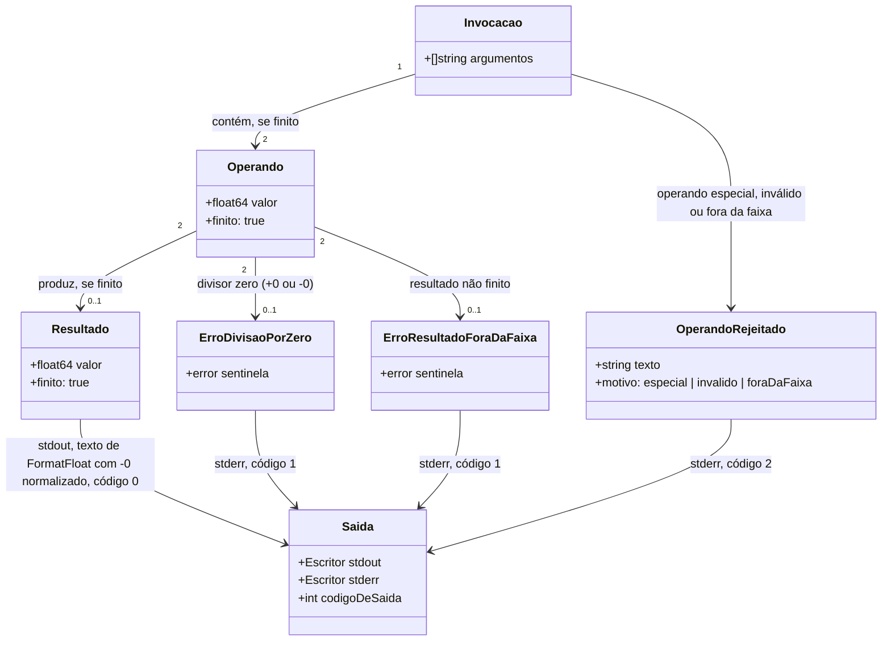

# Números especiais, faixa e formato de impressão da calculadora

Decisões resolvidas pelo humano: D-A10 (política "só finitos": entrada rejeita `nan`/`inf`/`infinity`, hexadecimais e sublinhados com código 2; overflow com operandos finitos é erro "resultado fora da faixa" com código 1; `NaN` como resultado deixa de existir; `1e999` continua fora da faixa com código 2), D-A9 (manter `strconv.FormatFloat` com `'g'` e `-1`), D-A9b (`-0` impresso como `0`) e D-A11 (separador decimal só o ponto). Decisões do planejador, propostas e contestáveis: D-B1 a D-B7 (ver `design.md`). Itens "não informados" que NÃO podem ser supostos na geração (se a geração depender de um deles, pare e pergunte): underflow (operando como `1e-999` e resultado como `1e-200 * 1e-200` seguem como estão, `0`, código 0, sem cenário nem teste), texto exato das mensagens de erro (só "em português, em stderr", com os trechos "fora da faixa" e "divisão por zero" onde a spec indica), D-A12 e D-A13 (herdadas, não alteradas). Fonte: `openspec/changes/numeros-especiais-e-formato/design.md` e `spdd/analysis/GGQPA-XXX-202611121739-[Analysis]-numeros-especiais-e-formato.md`.

## Requirements

Alterar a calculadora de linha de comando existente (`calc <operacao> <a> <b>`, `float64`) para que `NaN` e `Inf` nunca entrem como operando nem saiam como resultado: operandos especiais (`nan`, `inf`, `infinity`, hexadecimais, sublinhados, vírgula decimal) são entrada inválida (código 2); resultado não finito por overflow é erro de cálculo "resultado fora da faixa" (código 1); a impressão mantém o formato atual (menor texto que reconstrói o valor, uma linha) com o zero negativo normalizado para `0`. Nenhum caminho pode causar pânico, para que o usuário receba sempre um número finito legível em stdout ou uma mensagem em português em stderr, com código de saída que distingue entrada inválida (2) de erro de cálculo (1).

Limites: uma operação por execução e exatamente dois operandos; sem novas operações, modo interativo, vírgula, milhar, hexadecimal nem mudança do formato de impressão; sem tratar underflow; sem alterar o `harness.config.json`.

## Entities

Notas: entidades existentes reaproveitadas de `internal/cli/cli.go` (`Executar`, `interpretar`, `lerOperando`, `erroDeOperando`, `calcular`, `formatar`, `reportar`) e `internal/calculo/calculo.go` (`Somar`, `Subtrair`, `Multiplicar`, `Dividir`, `ErrDivisaoPorZero`). Nova: `ErrResultadoForaDaFaixa` (nome sugerido). Não criar hierarquias nem wrappers além do necessário. `OperandoRejeitado` é o `erroDeOperando` existente com mensagens distintas por motivo, não um tipo novo obrigatório.

## Approach

1. Separação de responsabilidades (inalterada):
   - Regra de cálculo em `internal/calculo`, sem E/S; interpretação, apresentação e códigos de saída em `internal/cli`; `cmd/calc/main.go` só liga o processo real. Não alterar `cmd/calc/main.go`.
2. Implementação técnica:
   - Apenas biblioteca padrão (`math`, `strings`, `strconv`, `errors`, `fmt`).
   - `lerOperando`: manter a ordem de decisão de D-B3 (`ErrRange` → "fora da faixa", código 2; outro erro do `ParseFloat` → "não é um número válido", código 2; texto aceito mas `NaN`/infinito, ou com `_`, ou hexadecimal `0x`/`0X` após o sinal → rejeição em português, código 2).
   - `calculo`: `ErrResultadoForaDaFaixa`; `Somar`, `Subtrair`, `Multiplicar` e `Dividir` devolvem `(float64, error)`; erro quando o resultado não é finito; em `Dividir`, divisor zero primeiro.
   - `cli`: `calcular` propaga o erro; `reportar` mapeia `ErrDivisaoPorZero` e `ErrResultadoForaDaFaixa` para 1 e o resto para 2; `formatar` normaliza o zero negativo e mantém `'g'` com `-1`.
3. Regras de negócio:
   - Só finitos na entrada e na saída; a validação do operando precede o cálculo (`divisao nan 0` → código 2).
   - `divisao 6 -0`, `divisao 0 0` → divisão por zero, código 1; `divisao 1e308 1e-308` → fora da faixa, código 1.
   - Formato: `5`, `0.30000000000000004`, `1e+22`, `0` para zero negativo; uma linha com quebra de linha final.
   - Separador decimal só o ponto.
4. Riscos e respostas: mudança de assinatura quebra testes de `calculo` (atualizar junto); o formato `'g'` produz `1e+06` para `500000 + 500000` (consequência aceita de D-A9; documentar no README); `ParseFloat` pode aceitar formas inesperadas (testes fixam rejeições e aceitação de decimais comuns); underflow não é decidido (não testar nem tratar).

## Structure

### Inheritance Relationships
1. Sem hierarquia de herança. Erros de domínio são valores que implementam `error`; `ErrDivisaoPorZero` e `ErrResultadoForaDaFaixa` são sentinelas independentes, comparados com `errors.Is`.
2. Nenhuma interface nova é necessária.

### Dependencies
1. `cmd/calc/main.go` depende de `internal/cli` (sem mudança).
2. `internal/cli` depende de `internal/calculo`.
3. `internal/calculo` não depende de outro pacote do projeto nem de E/S; passa a importar `math` para a checagem de finitude.
4. Pacotes de produção usam apenas a biblioteca padrão.

### Layered Architecture
1. Entrada (`cmd/calc`): inalterada.
2. Interpretação e apresentação (`internal/cli`): validação de operando, mapeamento erro → mensagem e código, formatação.
3. Cálculo (`internal/calculo`): quatro operações, os dois erros sentinelas, regra de finitude.
4. Tratamento de erros: `reportar` continua o único ponto que converte erro em stderr e código de saída; o cálculo só devolve erros.

## Operations

Ordem de execução: 1 → 2 → 3 → 4 → 5 → 6 → 7. Cada operação lista seu critério de conclusão. Alinhadas às tarefas em `openspec/changes/numeros-especiais-e-formato/tasks.md`.

### Conferir decisões e linha de base (tasks 1.1 e 1.2)
1. Responsabilidade: confirmar que `design.md` registra D-A10, D-A9, D-A9b e D-A11 como decididas, D-B1 a D-B7 como propostas e o underflow em Open Questions; medir a linha de base.
2. Pré-condição: fase `apply` declarada pela sessão principal.
3. Passos: ler `design.md`; rodar `go test ./...` e `go vet ./...`.
4. Conclusão: ambos terminam com código 0 antes de qualquer alteração.

### Cálculo: erro de faixa nas três operações (task 2.1)
1. Responsabilidade: devolver erro quando o resultado de soma, subtração ou multiplicação não for finito.
2. Lógica: `ErrResultadoForaDaFaixa` exportado (mensagem objetiva em português, "resultado fora da faixa"); `r := a + b` (e análogos); se `math.IsInf(r, 0) || math.IsNaN(r)`, devolver `0, ErrResultadoForaDaFaixa`; senão `r, nil`.
3. Testes (tabela em `calculo_test.go`): "Soma que estoura a faixa" (1e308, 1e308), "Multiplicação que estoura a faixa" (1e200, 1e200), "Subtração que estoura a faixa para o lado negativo" (-1e308, 1e308), "Resultado grande mas finito" (1e308, 1e307: sem erro, resultado finito); casos existentes (2+3=5, 5-3=2, 4*3=12) sem erro; verificar com `errors.Is`.
4. Conclusão: `go test ./...` passa.

### Cálculo: divisão (task 2.2)
1. Responsabilidade: dividir ou devolver o erro correto.
2. Lógica: se `b == 0` (cobre `-0`), devolver `0, ErrDivisaoPorZero`; senão calcular `a / b` e, se não finito, devolver `0, ErrResultadoForaDaFaixa`.
3. Testes: "Divisão que estoura a faixa" (1e308, 1e-308: `ErrResultadoForaDaFaixa` e não `ErrDivisaoPorZero`), "Divisor igual a zero negativo" (6, -0), "Zero dividido por zero" (0, 0), e os cenários existentes (6/3=2, 7/2=3.5, 6/0 erro, 0/3=0).
4. Conclusão: `go test ./...` passa; nenhum pânico.

### CLI: rejeitar `nan`, `inf`, `infinity` (task 3.1)
1. Responsabilidade: impedir que operandos não finitos cheguem ao cálculo.
2. Lógica: em `lerOperando`, após `ParseFloat` sem erro, se `math.IsNaN(valor) || math.IsInf(valor, 0)`, devolver `erroDeOperando` com mensagem em português que cita o texto original (sugestão: `operando %q não é um número finito válido`); manter a precedência de `ErrRange` (código 2, "fora da faixa").
3. Testes (tabela sobre `Executar`, conferindo stdout vazio, stderr não vazio e código 2): `divisao 1 nan`, `soma NaN 1`, `soma +nan 1`, `soma -NAN 1`, `divisao nan 0` (código 2, não 1), `soma inf -inf`, `soma Infinity 1`, `soma -INF 1`, `soma +Infinity 1`.
4. Conclusão: `go test ./...` passa.

### CLI: rejeitar hexadecimais e sublinhados (task 3.2)
1. Responsabilidade: rejeitar formas que o `ParseFloat` aceita mas a política "só finitos decimais" não admite.
2. Lógica: no texto aceito, rejeitar se `strings.Contains(texto, "_")` ou se, retirado um sinal opcional, o texto começa com `0x`/`0X`; mensagem em português, código 2.
3. Testes: `soma 0x1p-2 1`, `soma -0x1p-2 1`, `soma 1_000 1`, `soma 1 1_000` (stdout vazio, stderr não vazio, código 2).
4. Conclusão: `go test ./...` passa.

### CLI: regressões de entrada e ausência de pânico (task 3.3)
1. Responsabilidade: provar que o que deve seguir igual segue e que nada derruba o programa.
2. Testes: `soma 1,5 2` (código 2); `soma 1e999 1` e `soma -1e999 1` (código 2, stderr contém "fora da faixa"); `soma 1e3 -2.5` imprime `997.5` com código 0; `+5`, `.5` e `5.` ainda aceitos; uma tabela única com todas as entradas especiais das operações 3 a 5 que chama `Executar` e confirma que retorna (um pânico derrubaria o teste).
3. Conclusão: `go test ./...` passa.

### CLI: erro de faixa e código 1 (task 4.1)
1. Responsabilidade: levar o erro de faixa até o usuário.
2. Lógica: `calcular` devolve `(float64, error)` para as quatro operações; em `reportar`, `errors.Is` com `ErrDivisaoPorZero` ou `ErrResultadoForaDaFaixa` → `fmt.Fprintf(stderr, "erro: %v\n", err)` e código 1; o resto → 2. Pode renomear `CodigoDivisaoPorZero` (valor 1 inalterado).
3. Testes: `soma 1e308 1e308`, `multiplicacao 1e200 1e200`, `divisao 1e308 1e-308` (stdout vazio, stderr contém "fora da faixa", código 1); nenhuma saída contém `Inf` nem `NaN` em stdout.
4. Conclusão: `go test ./...` passa.

### CLI: divisão por zero reafirmada (task 4.2)
1. Responsabilidade: manter e reafirmar o contrato da divisão por zero.
2. Testes: `divisao 6 0`, `divisao 6 -0`, `divisao 0 0` (stdout vazio, stderr contém "divisão por zero", código 1). Os casos `-0` e `0 0` já existem em `cli_test.go`; manter.
3. Conclusão: `go test ./...` passa.

### CLI: formato e zero negativo (task 4.3)
1. Responsabilidade: fixar o formato atual e normalizar `-0`.
2. Lógica: em `formatar`, se `valor == 0`, tratar como `0` (descarta o sinal); depois `strconv.FormatFloat(valor, 'g', -1, 64)`; `Executar` continua com `fmt.Fprintln`.
3. Testes (comparar o texto exato de stdout com `\n` final): `soma 2 3` → `5\n`; `soma 0.1 0.2` → `0.30000000000000004\n`; `soma 1e22 0` → `1e+22\n`; `multiplicacao -1 0` → `0\n`; `soma -0 -0` → `0\n`. Não criar teste de underflow.
4. Conclusão: `go test ./...` passa.

### Integração e documentação (tasks 5.1 a 5.3)
1. Rodar `go vet ./...`, `gofmt -l .` e `go test ./...`: o primeiro e o terceiro com código 0 e o `gofmt` sem listar arquivos.
2. Atualizar o `README.md` (códigos de saída, política só finitos, formato de impressão incluindo a notação científica, separador decimal) e conferir executando `go run ./cmd/calc soma 1e308 1e308` (código 1), `go run ./cmd/calc soma nan 1` (código 2), `go run ./cmd/calc multiplicacao -1 0` (`0`) e `go run ./cmd/calc soma 0.1 0.2` (`0.30000000000000004`).
3. Registrar a change no `CHANGELOG.md`, com as mudanças de comportamento e o underflow como pergunta em aberto.
4. Fora desta change: `harness.config.json` e `CLAUDE.md`.

## Norms

1. Formatação e estilo: `gofmt`; nomes e erros idiomáticos de Go; documentação em português; identificadores seguem o código existente (português, D-A13 não alterada).
2. Injeção de dependências: argumentos e escritores de saída por parâmetro; sem variáveis globais mutáveis nem leitura de `os.Args`/`os.Stdout` fora do ponto de entrada.
3. Tratamento de erros:
   - Erros devolvidos como valor; `errors.Is`; embrulhar com `%w` ao acrescentar contexto.
   - Sem `panic`, sem `recover`, sem captura ampla (regra do `CLAUDE.md`).
   - Um único ponto (`reportar`) converte erro em stderr e código de saída (1 erro de cálculo, 2 entrada inválida).
4. Validação de dados: validar o operando antes de calcular; o cálculo ainda verifica a finitude do resultado.
5. Logging: nenhum; a comunicação com o usuário é a saída do programa.
6. Testes: tabela em `_test.go` ao lado do código; um caso por cenário das specs; texto exato de stdout nos cenários de formato (D-A9 está decidido); `go test ./...`; sem rede nem relógio.
7. Documentação: `README.md` e `CHANGELOG.md` atualizados; comentários de pacote e de símbolos exportados, em português.

## Safeguards

1. Restrições funcionais: apenas as quatro operações; dois operandos por execução; nenhum comportamento além do especificado nas specs deltas.
2. Restrições de desempenho: não informado; sem requisito.
3. Restrições de segurança: não ler nem escrever arquivos, rede ou variáveis de ambiente; nunca tocar em arquivos de credenciais; mensagens citam apenas o texto do operando digitado.
4. Restrições de integração: apenas biblioteca padrão do Go; `go.mod` inalterado (D-A12 não alterada).
5. Regras de negócio:
   - `NaN` e `Inf` nunca em stdout; nenhum resultado numérico acompanha um erro.
   - Operando rejeitado (código 2) nunca é reportado como divisão por zero.
   - `divisao 6 -0` e `divisao 0 0` são divisão por zero; `divisao 1e308 1e-308` é fora da faixa; ambos código 1.
   - `-0` nunca é impresso.
   - Underflow permanece como está; não adicionar tratamento nem teste.
6. Restrições de tratamento de erro:
   - Todo erro tem mensagem objetiva em português e os sentinelas são identificáveis com `errors.Is`.
   - Mensagens não expõem detalhes internos do sistema.
   - Nenhum caminho de código termina em pânico (verificado pela tabela de entradas especiais).
7. Restrições técnicas: escrever em `cmd/` e `internal/` somente na fase `apply`; não alterar `harness.config.json`; não alterar `openspec/` além dos checkboxes de `tasks.md` e de eventuais registros de decisão no `design.md`; sem `git add`/`commit`/`push` sem pedido explícito.
8. Restrições de dados: operandos e resultado `float64` finitos; separador decimal só o ponto; formato de impressão por `strconv.FormatFloat(valor, 'g', -1, 64)` com `-0` normalizado.
9. Restrições de interface (CLI): sintaxe `calc <operacao> <a> <b>` inalterada; resultado só em stdout com código 0; erros em português só em stderr; código 1 para divisão por zero e resultado fora da faixa; código 2 para uso, operando especial, operando inválido e operando fora da faixa.
